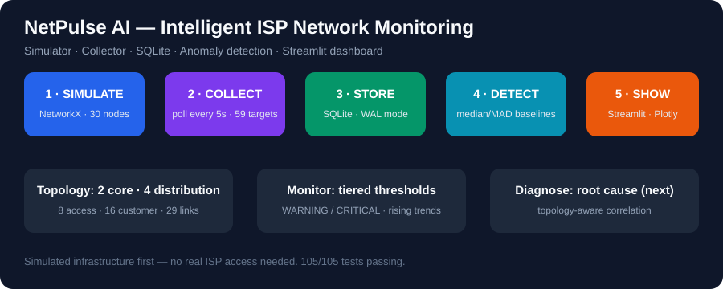

<div align="center">

# 📡 NetPulse AI

**Spot the outage before the customer calls — simulated ISP monitoring, anomaly detection and root-cause diagnosis on one dashboard.**


*Python · Streamlit · Pandas · scikit-learn · NetworkX · SQLite*

</div>

---

## 🎯 What this does

Small ISPs and network teams usually learn about outages from customer complaints — after the damage is done. NetPulse AI watches the network itself: it simulates and collects telemetry, monitors latency and packet loss, visualises topology, detects anomalies and traces them to a likely root cause, all on one dashboard.

> **The rule:** problems are found by the system, not by angry customers.

It is built for small ISPs and network operations teams that cannot afford enterprise network monitoring suites — and it is built entirely on simulated infrastructure first, so no real ISP access is needed to run the MVP.

## 🖼️ Architecture



```text
network/ (simulator) ──▶ monitoring/ (telemetry collector) ──▶ database/ (SQLite)
                                                                      │
                                                                      ▼
                                              intelligence/ (anomaly detection, diagnosis)
                                                                      │
                                                                      ▼
                                                         dashboard/ (Streamlit)
```

Data flows in one direction: the simulator produces a network, the collector measures it, storage keeps the history, the intelligence layer analyses it, and the dashboard presents it. The dashboard reads from SQLite only — never from the simulator or collector directly.

📸 **Screenshots:** the architecture diagram above is the visual reference for this repo. No real dashboard screenshot is included yet — add one later as `docs/screenshots/dashboard.png` and it will show here. No fake screenshots are included.

## ✅ What is built so far

5 of the 7 MVP stages are implemented, tested and merged to `main` (full suite: **105/105 tests passing**):

| # | Stage | Status |
|---|-------|--------|
| 1 | Network simulator | ✅ Merged — synthetic ISP topology, fault injection |
| 2 | Telemetry collector | ✅ Merged — polls every 5s, stores in SQLite |
| 3 | Latency & packet-loss monitoring | ✅ Merged — tiered thresholds, rolling trends |
| 4 | Network topology visualisation | ✅ Merged — interactive Plotly graph in Streamlit |
| 5 | Anomaly detection | ✅ Merged (PR #12) — learned per-target baselines |
| 6 | Root-cause diagnosis | ⏳ Remaining — topology-aware correlation, ranked causes |
| 7 | Monitoring dashboard completion | ⏳ Remaining — anomalies, diagnoses, history views |

See [`docs/ROADMAP.md`](docs/ROADMAP.md) for the six-week plan and [`docs/DEVELOPMENT_LOG.md`](docs/DEVELOPMENT_LOG.md) for what has been done so far.

## 🌐 The simulated network

A hierarchical ISP topology built with NetworkX — **30 nodes, 29 links**:

| Tier | Nodes | Baseline latency |
|------|-------|------------------|
| Core routers | 2 (`core_1`–`core_2`) | ~5 ms |
| Distribution nodes | 4 (`dist_1`–`dist_4`) | ~15 ms |
| Access nodes | 8 (`access_1`–`access_8`) | ~30 ms |
| Customer endpoints | 16 (`cust_1`–`cust_16`) | ~30 ms |

Healthy links run at under 0.5% packet loss. Faults can be injected to test the pipeline: **link congestion**, **node down** (attached links report down, 100% loss, 0.0 latency) and **flapping**. Nothing here touches a real network.

## ⚡ Quick start

```bash
git clone https://github.com/abdullacaad/netpulse-ai.git
cd netpulse-ai
python -m venv .venv
# Windows (PowerShell):
.venv\Scripts\Activate.ps1
# macOS / Linux:
source .venv/bin/activate
pip install -r requirements.txt
pytest
streamlit run dashboard/app.py
```

Then open the Streamlit URL it prints (usually `http://localhost:8501`).

## 🧠 How it works

- **Simulator (`network/`)** — deterministic, seeded NetworkX topology; `tick()` advances the simulation and `get_measurements()` returns one measurement per node and link (59 targets).
- **Collector (`monitoring/collector.py`)** — polls the simulator (default every 5 s) and writes timestamped latency, loss and status to SQLite. It owns the simulation clock; stored timestamps are simulation time. Inserts are idempotent and the database runs in WAL mode.
- **Monitoring (`monitoring/`)** — tiered threshold rules per network tier (Core 10/20 ms, Distribution 30/60 ms, Access/Customer 50/100 ms, Node 5/10 ms, loss 2%/5%) with `WARNING` / `CRITICAL` severities, plus rolling directional trends (`rising`, `falling`, `stable`) so operators get early warning before a hard breach.
- **Anomaly detection (`intelligence/anomaly.py`)** — per-target robust median/MAD baselines learned only from up-status telemetry, with explicit latency and packet-loss upper bounds stored alongside every detection. Flags latency, packet-loss, node-down and link-down anomalies with severity and evidence. (scikit-learn is reserved for later multivariate models; the statistical baseline is the current detector.)
- **Storage (`database/`)** — one SQLite database for all telemetry history, anomalies and diagnoses; schema and queries live in one place so no other module writes SQL directly.
- **Dashboard (`dashboard/`)** — Streamlit UI that reads `NetworkMonitor` status from SQLite via `NetworkMonitor.from_db()` and renders topology, live latency and loss, and (as stages land) anomalies and diagnoses.

## 🤖 How this project is built

Three AI assistants work on NetPulse AI using only free tiers, with GitHub as the single source of truth:

- **ChatGPT Free** — project planning, system architecture, research, technical review
- **Claude Free** — independent code review, debugging, documentation review
- **Google Antigravity (Individual, free)** — primary coding agent

They are not directly connected to each other. Context is shared through this repository: every assistant reads [`docs/PROJECT_CONTEXT.md`](docs/PROJECT_CONTEXT.md) before significant work, and work passed between assistants is recorded in [`docs/AI_HANDOFF.md`](docs/AI_HANDOFF.md). Changes go through feature branches and pull requests, merged only after human approval.

## 📂 Project layout

```text
src/           shared application code
monitoring/    telemetry collection, latency and packet-loss monitoring
intelligence/  anomaly detection and root-cause diagnosis
network/       network simulator and topology
database/      SQLite storage layer
dashboard/     Streamlit dashboard
tests/         automated tests (105 passing)
docs/          project context, architecture, decisions, roadmap, handoffs
data/          sample and simulated data
.github/       pull request template
```

## 📚 Docs

- [`docs/PROJECT_CONTEXT.md`](docs/PROJECT_CONTEXT.md) — what NetPulse AI is, and the rules every contributor follows
- [`docs/ARCHITECTURE.md`](docs/ARCHITECTURE.md) — modules, data flow, technology choices
- [`docs/DECISIONS.md`](docs/DECISIONS.md) — dated design decisions (simulated-first, free tiers only, threshold rules, storage limits)
- [`docs/ROADMAP.md`](docs/ROADMAP.md) — the 6-week MVP plan
- [`docs/DEVELOPMENT_LOG.md`](docs/DEVELOPMENT_LOG.md) — what was done, when, and by whom

## 📄 License

MIT — see [`LICENSE`](LICENSE).
